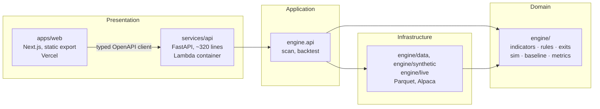

# Swing Scan

**Build a swing trading entry rule, backtest it honestly, and compare exit strategies on identical
entries.** A $0/month portfolio project, built in about ten days by directing AI coding agents.

[](https://github.com/comgood/swing-scan/actions/workflows/ci.yml)
**[Live demo](https://swing-scan-one.vercel.app)** · 52/52 acceptance criteria green · no sign up

> **Not investment advice.** The public demo runs on a **generated** market, not real prices, and
> the generated market has a **planted** edge, so any strategy will look good on it. Nothing here
> is a recommendation to buy or sell anything.

<!--
  The demo GIF goes here once recorded. Swap this comment block for:
      
  See "Recording the demo" at the bottom of this file for the shot list.
-->

> 🎬 **Demo GIF pending.** Until then, the [live demo](https://swing-scan-one.vercel.app) is the
> real thing and the [demo script](#demo-script-2-to-3-minutes) below is the two minute tour.

## The idea

Most backtesting tools let you tune an entry rule until the equity curve looks good, which is how
you end up with a strategy that fits the past and nothing else. This one is built around three
things that make it harder to fool yourself:

1. **The exit lab holds entries fixed.** Pick one entry rule, then compare up to six exit setups
   on the *same* trades. Any difference in the results is caused by the exit, and that is asserted
   by an oracle test, not assumed.
2. **A random entry baseline runs beside every result.** Random entries in the same market go
   through the same exits. The gap between your rule and that baseline is the part that is not
   just market drift. In the [published research note](docs/research-notes/0001-fixed-vs-trailing-stop-synthetic.md)
   the chosen strategy's out of sample expectancy **quadrupled** while its edge over random
   **fell 78%** — the baseline is what caught it.
3. **Every look costs you something visible.** A trial counter keyed on rule *structure* (so
   changing a number does not reset it) counts how many times you have looked, and warns at ten.
   In sample results are highlighted; out of sample sits beside them, to be read once.

Plus the boring honesty: expectancy **per bar held** next to plain expectancy, MAE and MFE guides
from in sample winners only, distinct entry *weeks* as the real sample size rather than trade
count, and an assumptions header on every result stating the fill model, slippage and cooldown.

## Demo script (2 to 3 minutes)

1. **0:00** The public URL, with the "Synthetic market: not real prices" banner. Free vendor data
   cannot be redistributed, so this is a generated market with planted delistings.
2. **0:15** The builder opens on the **Breakout** template. Change the volume multiple 1.5 → 2.0,
   add `rsi(14) < 75`, and watch the URL and the JSON panel update as you type.
3. **0:45** Scan results: "new today" flags and the operand values per ticker, so you can see
   *why* each row matched.
4. **1:00** A single config backtest: the assumptions header, the equity curve against
   `DEMO-INDEX` with the in sample and out of sample split marked, and the trade list filtered to
   `exit_reason = delisted`.
5. **1:20** The **exit lab** on five configs. Same entries, only the exit changes. Read the
   **edge vs random** column, then **expectancy per bar** beside plain expectancy: the trailing
   stop looks best per trade and loses per bar held. Read the MAE guide: "90% of winners never
   went below −6%, so an 8% stop is loose." Glance at out of sample once.
6. **2:10** Change the breakout lookback 252 → 100 and re-run. The trial counter moves and the
   overfitting warning appears.

## Architecture



Every arrow points inward, and nothing points back out: the domain knows nothing about the API,
the web app, Parquet or Alpaca.

Clean Architecture, with the dependency rule enforced by a test rather than a convention:
[`engine/tests/test_engine_boundary.py`](engine/tests/test_engine_boundary.py) fails the build if
the domain imports FastAPI, Starlette or uvicorn. The API is ~320 lines because every decision
lives inward of it; routers assemble responses and nothing else.

Exit precedence lives in exactly one function, `step(position, bar)`, and "never special case an
exit outside it" is an enforced invariant. Both the portfolio day loop and the per trade exit lab
loop call it, so the two modes cannot disagree about what an exit does.

**Read more:** [spec 0001 (stack)](docs/specs/0001-stack-architecture/index.md) ·
[all 10 specs](docs/specs/) · [ADR digest, 17 decisions tracked to outcomes](docs/adr-digest.md) ·
[agent log: how it was built](docs/agent-log.md)

## Tech, honestly

| | | Why |
|---|---|---|
| **TypeScript** (strict) on Node 24, **Next.js** App Router | static export | No server needed, so Vercel Hobby hosts it free |
| **Tailwind** + shadcn/ui, TanStack Query/Table, Lightweight Charts | | Tables and charts are most of the UI |
| **Python 3.12** (uv), **FastAPI** + Pydantic v2 | Lambda container, `ap-southeast-1` | Pydantic models are the contract, and generate the TypeScript client |
| **Polars** (indicators and rules), **NumPy** and plain Python loops (simulator) | | Deliberately not Numba or vectorbt. Profiling decided this, not taste — see ADR-006 and 016 |
| **No database, no auth, no background jobs** | | 10 to 20 MB of Parquet ships inside the image. State lives in the URL |
| pnpm + uv monorepo, one `Makefile` | | `make ci` runs everything CI runs |

Things it deliberately does **not** have: accounts, saved rules, alerts, watchlists, OR groups in
rules, intraday data, fundamentals, short selling, parameter sweeps, walk forward, Monte Carlo, or
hosted real data. Those are listed as non goals, not oversights.

## $0/month, specifically

| Piece | How it is free |
|---|---|
| Web app | Vercel Hobby, static export, deployed from Git |
| API | AWS Lambda always free tier. 2,048 MB, 30 s timeout, x86_64, one container image |
| Image registry | ECR, images tagged with the commit SHA |
| Data | No database. Synthetic Parquet is built into the image |
| CI/CD | GitHub Actions, free on a public repo. Deploys use OIDC, so **no AWS keys are stored** |
| Staying awake | One `/api/v1/health` call a week, so the image does not go Inactive and spoil the first visit after a quiet spell. Not a warm up ping — the web app does that itself on page load |
| Guard rails | A **$1 budget alarm** and a throttle alarm, both by email |

Measured cold start for a visitor hitting an idle function: **2.66 s** (warm: 0.07 s). The first
call right after a *deploy* is slower and different, 9 to 14 s, because Lambda optimises each new
image once; `infra/README.md` §6 keeps the two numbers apart so neither gets quoted as the other.

## Limits of the research

All of these point the same way: **results look better than reality.**

1. **Survivorship (live data):** Alpaca's free tier returns no bars for delisted names. Companies
   that died are simply missing.
2. **Index selection look ahead (live data):** the universe is *today's* S&P 500. Many names were
   added *because* they rose. A 2018 breakout in a company that joined the index in 2023 is a
   trade nobody could have screened for. This hits breakout and momentum rules hardest, which is
   exactly what the templates are, and it is probably bigger than plain survivorship.
3. **One regime out of sample:** the out of sample window is mostly a bull market. A long only
   momentum rule can pass it without being robust.
4. **Short history:** few sharp drawdowns in the window.
5. **Multiple testing:** many entry tweaks times up to six exits. Every look at out of sample
   makes it less out of sample.
6. **Trade mode ignores capital:** no slot competition, no correlated drawdowns. Distinct entry
   weeks are the honest sample size.
7. **The synthetic market's edge is planted.** A documented momentum term. Templates look good
   there by construction. Synthetic results demonstrate the method and the engine's correctness,
   never a strategy.
8. **Costs are simple:** 10 bps slippage, no commission, no borrow, no taxes.

**Therefore every finding here is a hypothesis.** Confidence would need delisted inclusive data,
walk forward testing, and a paper traded forward test. The research note states its own confidence
level and names which of these limits bite it.

## Data licence

- **The public demo, the GIF, CI and every fixture use synthetic data only.** No real prices are
  committed, hosted, or shown anywhere public.
- **Live mode is local only.** Alpaca's free plan is **personal, non commercial use only**, so
  live bars are loaded to a gitignored `data/live/` on one machine and never published. The API
  refuses to start in live mode anywhere but `127.0.0.1`, and refuses on Lambda or in CI whatever
  the binding says.
- **Aggregate metrics from live data count as derived data and are never published.** Research
  notes run on live data stay in a gitignored `research/` folder; only synthetic notes are
  published.
- Enforced rather than promised: a data leak guard and gitleaks run pre commit and in CI, and
  `data/` and `research/` are gitignored.

## Running it

```bash
make setup      # install from lockfiles (pnpm --frozen-lockfile, uv sync --frozen)
make hooks      # once per clone: install the pre-commit hooks
make data       # generate the seed 42 synthetic market into data/synthetic (gitignored)
make dev        # API on 127.0.0.1:8000 + web on :3000
make ci         # every check CI runs, in one command
```

Live mode, local only, needs Alpaca keys in your environment or a local `.env`:

```bash
make load-live  # Alpaca daily bars into data/live (gitignored)
make dev-live   # the same app against your live data, on 127.0.0.1 only
```

## Tests

| Suite | What it is |
|---|---|
| **26 oracle tests** (`tests/oracle/`) | Owner written correctness tests, protected by a pre commit guard and a CI label so no agent can edit them. They define correct behaviour for every exit type, loop parity, look ahead and MAE/MFE, and they were written **before** the engine |
| **141 acceptance tests** (`tests/acceptance/`) | Written from the criteria and contracts only. All **52 MUST criteria are `required` and green**; `test_traceability.py` fails the build if the gate and the traceability matrix disagree |
| **710 Python tests**, ~450 web tests | Unit tests beside their packages, plus Vitest for the UI |
| **Golden references** (`tests/golden/`) | Naive loop implementations that the fast paths are checked against |

```
make test · make test-acceptance · make test-oracle · make lint · make typecheck
```

## Recording the demo

The GIF above is the one artifact that needs a human. Record the six steps of the demo script
against `make dev` on the seed 42 market, at 375 px wide (every page is checked to work there), and
save it to `docs/assets/demo.gif`. Keep it under about 10 MB so it loads on this page, and make
sure the synthetic banner is legible in the first frame — it is the first thing the GIF has to say.

---

A learning and portfolio project with one real user, never sold.
[Why there is no monetisation.](docs/01-market-research-and-product-spec.md#9-why-there-is-no-monetisation)
